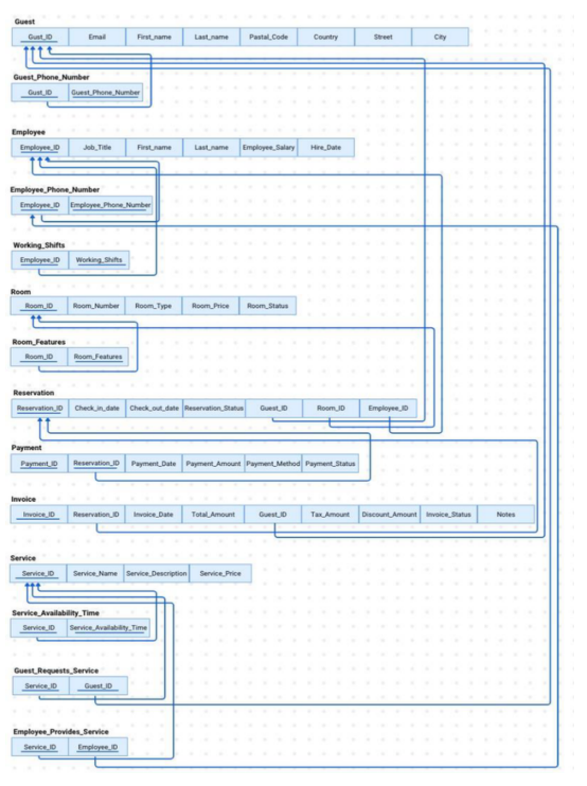

# 🏨 Hotel Database Management System

A **MySQL database system** designed to organize hotel operations, including guests, rooms, reservations, payments, invoices, employees, and services.

## Features

- **Guest and room records:** Store guest details, room types, prices, and availability.
- **Reservations:** Manage room bookings and reservation statuses.
- **Payments and invoices:** Track transactions and billing information.
- **Employees and services:** Organize staff records and guest services.
- **Database relationships:** Relational tables with primary and foreign keys.
- **Advanced SQL:** Joins, subqueries, aggregate functions, views, a stored procedure, a function, and a trigger.

## Technologies

- MySQL
- SQL
- Database Design & Modeling
- Entity–Relationship (ER) Diagrams

## Database Schema

## SQL Files

| File | Purpose |
| --- | --- |
| `sql/01_schema.sql` | Database tables, relationships, constraints, and a trigger |
| `sql/02_sample_data.sql` | Fictional demonstration records |
| `sql/03_queries.sql` | SQL queries, views, stored procedure, and function |

## How to Run

Open **MySQL Workbench** and run these files in order:

1. `sql/01_schema.sql`
2. `sql/02_sample_data.sql`
3. `sql/03_queries.sql`

> The third script contains sample `INSERT`, `UPDATE`, and `DELETE` statements. Run it on the sample database only.

## Team Members

- Layan Mubarak Alotaibi
- Rahma Hayyan Araki
- Farah Saeed Abu-Mustafa
- Baraa Abdul Mohsen Derbaa
- Munyah Bedah Alhajri
- Reema Fayez Almutairi
